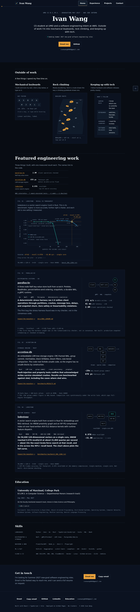

# iwang-1.github.io

**Live at <https://iwang-1.github.io/>**
[](https://github.com/iwang-1/iwang-1.github.io/actions/workflows/deploy.yml)



Ivan Wang's personal recruiting site — a multi-page React + TypeScript + Vite
app deployed to GitHub Pages at <https://iwang-1.github.io/> (user site, so
Vite `base: '/'`). No router, no chart libraries, no CDN fonts, no trackers, no
runtime dependency beyond React.

## The design system, in one paragraph

**DOUBLE-SHOT** — the page is set like a mechanical-keyboard spec sheet. The
palette is a keycap set: the page is alpha beige, every figure is case grey,
legend ink is charcoal, and the one accent is a rust modifier. Every colour
resolves through two layers of custom properties (raw → semantic) in
[`src/styles/tokens.css`](src/styles/tokens.css), so a theme swap edits about a
dozen raw values and nothing else. **No italics anywhere** — the two shipped
faces have no italic cut, so a browser would synthesise a slanted fake, and
`npm run verify` fails the build if one appears.

Two rules make it cohere, and they pull in opposite directions on purpose:

- **Plots keep a hairline grammar.** Measured figures are drawn like plots —
  1px rules, mono tick labels, footnote strips carrying measurement conditions
  and limits.
- **Drawings look drawn.** The keyboard and the boulder are objects, not charts.
  A keycap is two shapes so its sculpted top reads as raised out of its wall; a
  climbing hold is three (shadow, body, bolt) so it reads as bolted to plywood.
  An earlier version drew both in the plot grammar — its own source called a
  keycap "a tick label that happens to be square" — and the result was that one
  template appeared to have made every figure on the page.

## Page map (Vite MPA — `build.rollupOptions.input`)

| Route | Entry | Page module |
| --- | --- | --- |
| `/` | `index.html` | `src/pages/home/main.tsx` — hero (readout rail), Outside of work (`#off-hours`: the drawn keyboard, the boulder, a follow list), Featured engineering work (`#systems`: three spec sheets + the recall-curve figure), Background (`#background` / `#education` / `#skills`) |
| `/experience/` | `experience/index.html` | `src/pages/experience/main.tsx` — center-spine alternating timeline: 4 engineering + 3 community & teaching roles |
| `/projects/` | `projects/index.html` | `src/pages/projects/main.tsx` — three system spec sheets (parallax-kv, accretion-db, lodestone), then the selected projects |
| `/404.html` | `404.html` | `src/pages/not-found/main.tsx` — branded not-found (GitHub Pages serves it natively; `noindex`) |

The hobbies come before the work by owner call: personality first, then proof.

Each entry hand-writes its own head (title, description, canonical, OG,
JSON-LD). Shared components live in `src/components/`; every fact rendered on
any page lives in one typed module, [`src/content.ts`](src/content.ts), and is
checked against the human checklist in [`FACTS.md`](FACTS.md) by
`scripts/check-facts.mjs` on every build.

## Numbers come from committed benchmarks, not from prose

The recall-vs-throughput figure on the home page is **generated at build time**
from [`benchmarks/lodestone/bench_50k_128d.txt`](benchmarks/lodestone/bench_50k_128d.txt),
a verbatim copy of lodestone's own committed benchmark output.
`scripts/generate-figures.mjs` parses it, emits `src/generated/sweep-figure.ts`,
and **asserts that every number it renders is a byte-exact substring of that
file** — then fails the build if the source is missing. A figure cannot drift
from its measurement by being edited, because it is not authored by hand.

The same reasoning drives the fact gate: `scripts/check-facts.mjs` holds a list
of required exact strings and forbidden patterns, including retired claims that
were found to be overstated. One of those tripwires originally matched a single
spelling of a retracted speedup figure; probing it showed it missed the em-dash,
spaced-hyphen, spelled-out-"to", bare-multiplier and stale-QPS forms of the same
claim, so it now catches all of them. A retracted number creeps back in a
slightly different skin.

(This gate scans `README.md` too, and it caught a draft of the sentence you just
read for quoting one of the banned spellings verbatim. That is the intended
behaviour: prose *about* a retired claim is still a copy of it.)

## Develop

```bash
npm install
npm run dev        # generates figures, then the dev server (MPA: /, /experience/, /projects/)
npm run check      # figure generation + fact/framing gate (also runs as prebuild)
npm run typecheck  # tsc -b
npm run lint       # eslint .
npm run build      # tsc -b && vite build && prerender  → dist/ (static #root markup)
npm run verify     # serves dist/ + drives every page in headless Chromium
```

All five must pass before anything is pushed. `npm run verify` requires the
Playwright Chromium browser (`npx playwright install chromium` once, if not
already cached). It drives every page at 1366×900, 390×844 and 320×700 and
checks: head metadata, sticky route progress, nav active state, internal links,
locked facts, a11y gates, zero console errors, no synthesised italics,
light-surface luminance, caption/figure non-overlap, mid-token wrapping,
primary-CTA contrast at rest **and** on hover, and the boulder's honesty
contract (exactly three sequences, all three identical in computed stroke
weight — the moment one is heavier the drawing is asserting a single correct
route, which contradicts the paragraph beside it).

Every gate in `verify.mjs` was proven to fail by reintroducing the defect it
names. A gate nobody has broken on purpose is not known to be a gate.

`npm run verify` also refreshes the per-page screenshots in `docs/`; the PNG
bytes are not deterministic, so commit them when they change meaningfully and
otherwise `git checkout -- docs` to keep the tree clean.

`public/og.png` is a generated 1200×630 branded card — regenerate with
`node scripts/generate-og.mjs` after brand changes. Fonts are self-hosted and
subset (`scripts/subset-fonts.mjs`); both licences travel with them in
`public/fonts/`.

The publish script additionally runs a private pre-push scan (kept outside this
repo on purpose) before anything is pushed.

## Deploy

`.github/workflows/deploy.yml` builds and deploys `dist/` to GitHub Pages on
every push to `main` (fact gate → build → `actions/deploy-pages`). The MPA
build needs no workflow changes — the whole `dist/` directory is uploaded,
including `experience/index.html`, `projects/index.html`, and `404.html`
(which GitHub Pages serves natively for unknown paths).

## Further reading

- [`PRODUCT.md`](PRODUCT.md) — product truth and the binding constraints on what
  the site may claim.
- [`DESIGN.md`](DESIGN.md) — the design system as built, including the only two
  places a literal value (rather than a token) is correct.
- [`FACTS.md`](FACTS.md) — every rendered number mapped to its source.
